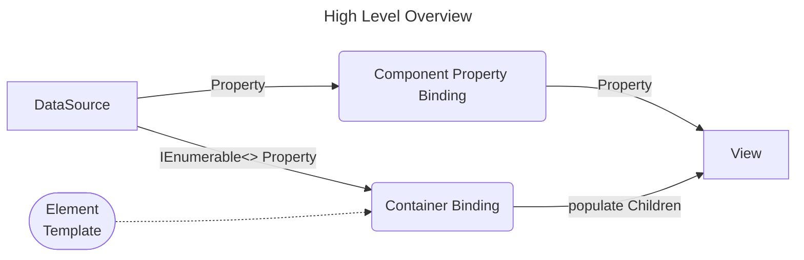

# Unity DataBinding

Bind your GameObjects directly to your data models — clean, reactive, and maintainable.

Updating GameObjects manually is:
- repetitive
- error-prone
- hard to maintain

This package lets you declare type safe and validated bindings instead of writing glue code. It's like WPF for Unity GameObjects. 

### Tutorials

- [Getting Started](Documentation~/GettingStarted.md) (Detailed Step by Step Tutorial - 5 minutes to complete)
  
  

   Create a simple scene showing a cube that randomly changes scale and color. This tutorial will make you familiar with fundamental ideas of this tool.

   ---

- [How to react to user input](Documentation~/HowToReactToUserInput.md) (Step by Step Tutorial - 5 minutes to complete)
  
  

  Starting from a simple scene that renders some input controls fill in the blanks that makes user input available to your application logic.
  
  ---

- [A look at ContainerBindings](Documentation~/ALookAtContainerBindings.md) (Step by Step Tutorial - 5 minutes to complete)

  

  Concerning user interface tool sets:  When it comes to handling not just static but dynamic content is where the wheat is separated from the chaff. Starting with some basic prefabs you will put together a nice little party panel for your characters in this tutorial.

### Runtime accessor execution

Component and container bindings cache executable property paths built with
`MethodInfo.CreateDelegate`. Component bindings share typed transfers between matching
getter and setter value types, avoiding intermediate boxing and setter argument arrays.
Changing a binding resolves its new path at runtime; no binding source code is generated.

Mono, IL2CPP, and WebGL use the same executor. Fixed AOT references cover common primitive
and Unity value types. Struct receivers and signatures that cannot create a delegate use
cached reflection fallbacks. Numeric conversions retain the reflection binder's behavior.
`PropertyAccessorChain.UsesReflection` and `ReflectionFallbackReason` identify fallback paths.

Properties accessed only through bindings must survive player stripping, just as with
reflection-based execution. Preserve application members with `[Preserve]` or `link.xml`,
and use `link.xml` for Unity component properties. See
[Unity's managed code stripping documentation](https://docs.unity3d.com/6000.0/Documentation/Manual/managed-code-stripping.html).

### Planned next steps:
- Improve automatic tests
- Add samples for new features
- Update existing samples 
